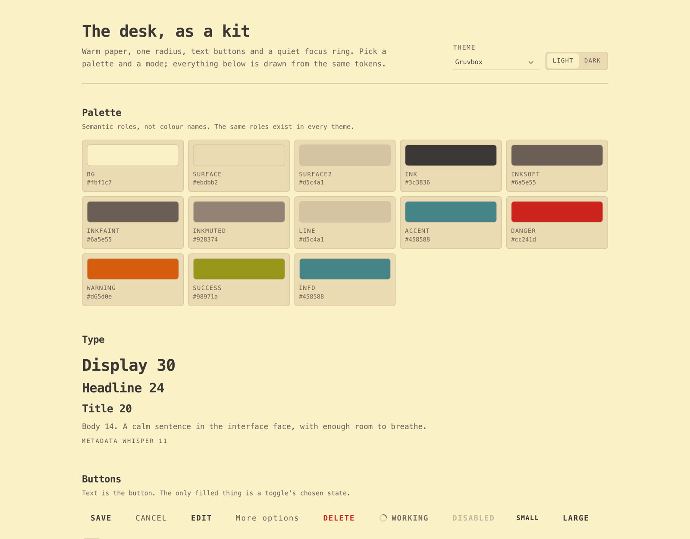

# @monos/ui

A Svelte 4 component kit: 58 primitives, a Tailwind preset, and a plain-CSS token layer with six themes in light and dark. The tokens work without Svelte or Tailwind; the components are source files that your bundler compiles.

[](https://github.com/aa-blinov/monos-ui/actions/workflows/ci.yml) [](https://aa-blinov.github.io/monos-ui/)

The interface kit extracted from [Monos](https://github.com/aa-blinov/monos): warm paper, one radius, text buttons and a focus ring that belongs to the theme. The design system itself, in one page: [DESIGN.md](DESIGN.md).

> **Status:** 1.0.5, source distribution. Not on npm yet; install from this repository.

**Live gallery:** [aa-blinov.github.io/monos-ui](https://aa-blinov.github.io/monos-ui/)



---

## Install and quick start

```bash
# from GitHub, until it is published on npm
npm install github:aa-blinov/monos-ui svelte tailwindcss
```

Peer dependencies: `svelte@^4` and `tailwindcss@^3.4`.

### 1. Tailwind preset

```js
// tailwind.config.js
import ui from '@monos/ui/tailwind-preset';

export default {
  presets: [ui],
  content: ['./src/**/*.{svelte,js}', './node_modules/@monos/ui/src/**/*.svelte'],
};
```

The preset names the semantic colours (`bg-canvas`, `bg-surface`, `text-ink`, `border-line`, `text-danger`), the one radius (`rounded-ui`), the whisper sizes, the shadows, the durations and the z-layers. Components use those names, never raw palette values.

### 2. Styles

```js
import '@monos/ui/styles.css';
```

`styles.css` brings the geometry tokens, all six themes and the optional base (page colour, font, focus ring, scrollbars, placeholders). If your product owns `body`, import `@monos/ui/tokens.css` and `@monos/ui/themes.css` instead.

### 3. Pick a theme

No JavaScript needed:

```html
<html data-theme="gruvbox" data-mode="dark"></html>
```

Themes: `gruvbox`, `github`, `dracula`, `nord`, `solarized`, `catppuccin`. Modes: `light`, `dark`. Without attributes the page is Gruvbox light; `data-mode="dark"` alone is Gruvbox dark.

### 4. Write a screen

```svelte
<script>
  import { Button, Card, Modal, TextField } from '@monos/ui';
  let open = false;
</script>

<Card interactive on:click={() => (open = true)}>
  <p class="text-sm font-bold">A note</p>
  <p class="mt-1 text-xs text-ink-soft">Warm paper, one radius, no decoration.</p>
</Card>

<Button on:click={() => (open = true)}>New note</Button>

<Modal bind:open title="New note" description="The title becomes the file name.">
  <TextField label="Title" placeholder="Untitled" />
  <svelte:fragment slot="footer">
    <Button variant="secondary" on:click={() => (open = false)}>Cancel</Button>
    <Button on:click={() => (open = false)}>Create</Button>
  </svelte:fragment>
</Modal>
```

## What it does

- **A component set, not an app shell.** 58 Svelte 4 primitives cover actions, fields, choices, overlays, feedback, navigation, data and layout. The product supplies the content and the routes.
- **One visual system, six palettes.** Every component reads a semantic `--ui-*` role; `data-theme` and `data-mode` swap the values. A new theme is data in `src/themes.js`, not a component branch.
- **Text buttons and one radius.** Actions are words. The only frame is a toggle's chosen state. Every rectangle uses the 6px `--ui-radius`.
- **A token layer that stands alone.** `tokens.css` and `themes.css` work in plain CSS or any framework; Svelte is only needed for the components.
- **A Tailwind bridge.** `tailwind-preset.js` exposes the roles as utility names, so host code writes `bg-surface text-ink border-line` instead of arbitrary values.
- **Accessible defaults.** The focus ring is a theme token. Text roles clear WCAG AA on the page and on a card in all twelve theme and mode pairs. Overlays trap and restore focus.
- **The gallery is the reference.** Every component is shown in every theme and both modes; the gallery is built from the same source a consumer imports.

### Components

| Component                      | What it is                                                                                                     |
| ------------------------------ | -------------------------------------------------------------------------------------------------------------- |
| `Button`                       | Text-only action: `primary`, `secondary`, `text`, `quiet`, `danger`; sizes `sm`, `md`, `lg`; `loading`, `full` |
| `IconButton`                   | 28/36/44px square, outline or ghost, always named by `label`; tooltip by default                               |
| `TextField`                    | Underline or boxed input with label, hint, error                                                               |
| `TextArea`                     | The same field, multi-line                                                                                     |
| `Select`                       | Themed listbox: the popup is drawn by the kit                                                                  |
| `SelectField`                  | Native select for forms, themed closed control                                                                 |
| `Combobox`                     | Searchable single choice; typed filter, listbox, active descendant                                             |
| `MultiSelect`                  | Searchable multiple choice; chips inside the field                                                             |
| `DatePicker`                   | ISO string + drawn calendar; `Intl` month and weekday names                                                    |
| `Slider`                       | Native range, themed track and thumb                                                                           |
| `FileUpload`                   | Drop zone and file list; `files` is data, not a transport                                                      |
| `Fieldset` / `FormField`       | Named group; label, hint and error around any control                                                          |
| `SearchField`                  | Pill search with magnifier and clear                                                                           |
| `Checkbox`                     | 16px box, 24/44px row                                                                                          |
| `Switch`                       | `role="switch"` row                                                                                            |
| `Chip`                         | Quiet bordered label; optional remove                                                                          |
| `Badge`                        | Uppercase status word with optional dot                                                                        |
| `Card`                         | Surface; `interactive` makes it a button, `selected` marks it                                                  |
| `Menu`                         | Trigger slot + data items; keyboard, outside click, Escape                                                     |
| `Modal`                        | Focus trap, Escape, backdrop, scroll lock, focus return                                                        |
| `Notice`                       | Inline status, warning, success or error                                                                       |
| `SegmentedControl`             | Pressed choice in a group                                                                                      |
| `EmptyState`                   | Icon, title, sentence, actions                                                                                 |
| `Kbd`                          | Key cap                                                                                                        |
| `Spinner`                      | Loading ring                                                                                                   |
| `Tabs`                         | WAI-ARIA tab list; line or pill; arrows, Home/End; panel slot                                                  |
| `Accordion`                    | Disclosure stack; one or many open; heading buttons                                                            |
| `Popover`                      | Anchored non-modal panel; trigger slot; flips, Escape, outside click                                           |
| `AlertDialog`                  | `role="alertdialog"` confirmation; focus starts on Cancel                                                      |
| `RadioGroup`                   | Real radios, one name, custom circle                                                                           |
| `Progress`                     | Determinate and indeterminate bar; tones; reduced motion                                                       |
| `Skeleton`                     | Reserves the size; pulse stops under reduce motion                                                             |
| `Avatar`                       | Image or initials; five sizes; status dot                                                                      |
| `Table`                        | Sortable, selectable data table; cell slot; sticky header                                                      |
| `Toaster` / `toast`            | Queue, auto-dismiss, actions; danger is an alert                                                               |
| `Breadcrumbs`                  | Path back up; the last item is the current page                                                                |
| `PageHeader`                   | Title, sentence and actions; heading level is a prop                                                           |
| `Pagination`                   | First, last and the current neighbourhood; real ellipsis                                                       |
| `Drawer`                       | Modal side panel with focus trap, scroll lock and focus return                                                 |
| `Prose`                        | Reading column for Markdown: measure, rhythm, code, tables                                                     |
| `Container` / `Stack` / `Grid` | Page column; one-dimensional stack; equal or auto-fit tracks                                                   |
| `Section` / `Separator`        | Vertical rhythm; a hairline, decorative or semantic                                                            |
| `Stepper`                      | Step sequence, current check and optional clicking                                                             |
| `NavItem`                      | One navigation row; link or button, active state                                                               |
| `List` / `DescriptionList`     | Rows with icon/meta; term and description                                                                      |
| `Portal` / `FocusTrap`         | Move an overlay out of its parent; keep Tab inside a region                                                    |
| `Tooltip` / `tooltip`          | Hint on any element; one look, 450 ms, never on a phone                                                        |
| `TopBar`                       | Phone navigation bar: back, title, actions; pads the top safe area                                             |
| `BottomNav`                    | Phone tab bar of three to five destinations; badge, current mark, pads the home indicator                      |
| `BottomSheet`                  | Modal panel from the bottom edge; focus trap, Escape, backdrop, drag-down to close                             |
| `ListRow`                      | 44px touch row: icon, title, second line, value, chevron; link or button                                       |
| `Fab`                          | Floating action pill with a word, above the home indicator                                                     |
| `MindMap`                      | SVG mind map from a tree: both-sided or rightward, fold, pan, zoom, arrow-key tree navigation                  |
| `DeviceFrame`                  | Preview frame at a profile's real screen size: desktop, laptop, tablet, mobile, watch                          |

Full props, events and slots: [docs/components.md](docs/components.md). Tokens: [docs/tokens.md](docs/tokens.md). Moving Monos itself onto the kit: [docs/migrating-monos.md](docs/migrating-monos.md).

## Configuration

The package has six entry points and two DOM attributes; there is no runtime configuration object.

| Entry point                 | What it gives you                                                    |
| --------------------------- | -------------------------------------------------------------------- |
| `@monos/ui`                 | The 66 components, the tooltip action, the toast store, the palettes |
| `@monos/ui/styles.css`      | `tokens.css`, `themes.css` and `base.css` in that order              |
| `@monos/ui/tokens.css`      | Geometry, type, motion and z-index tokens                            |
| `@monos/ui/themes.css`      | The colour blocks for every theme and mode                           |
| `@monos/ui/tailwind-preset` | Semantic names for Tailwind                                          |
| `@monos/ui/themes`          | The palette data, `themeNames` and `modes`                           |

| Attribute    | Values                                                            | Default   |
| ------------ | ----------------------------------------------------------------- | --------- |
| `data-theme` | `gruvbox`, `github`, `dracula`, `nord`, `solarized`, `catppuccin` | `gruvbox` |
| `data-mode`  | `light`, `dark`                                                   | `light`   |

Set both attributes on `<html>`. The selectors are `:root`, `:root[data-mode="dark"]:not([data-theme])` and `[data-theme="…"][data-mode="…"]`; anything else falls back to Gruvbox light. Colour tokens are plain values, so Tailwind's `/opacity` modifier does not apply to them; use `color-mix()` as the kit does.

## How it works

Three layers, one direction of dependency:

```
src/themes.js          palette data, six themes, two modes
      |
      v
src/theme-css.js       contrast walker + CSS renderer
      |
      v
src/styles/themes.css  generated and committed
src/styles/tokens.css  geometry, type, motion, z
src/tailwind-preset.js the same names as Tailwind utilities
      |
      v
src/components/*.svelte  58 primitives reading roles
      |
      v
src/index.js          the public surface
```

`npm run build:themes` turns the palette data into `src/styles/themes.css`. The CSS is committed so a consumer can import it without running the generator; `tests/themes.test.js` regenerates it and fails when the committed file is out of date. The status-word roles (`--ui-danger-text` and siblings) are computed by darkening or lightening the signal until the word clears AA on both `--ui-bg` and `--ui-surface`, keeping the hue.

Components never write a hex or an `rgb()` value, and never import from an application. `tests/contract.test.js` enforces both, and every `.svelte` file in `src/components/` has to be exported from `src/index.js`.

### Repository layout

```
src/
  components/          Svelte 4 primitives
  styles/
    tokens.css         geometry, type, motion, z
    themes.css         generated palette blocks
    base.css           optional page base
    index.css          all of the above
  themes.js            palette data
  theme-css.js         the generator shared by the build and the tests
  tailwind-preset.js   semantic names for Tailwind
  tooltip.js           the shared tooltip action
  index.js             the public surface
gallery/               the visual reference
gallery/sections/      one component per gallery section
tests/                 contract, contrast and behaviour tests
docs/                  architecture, components, tokens, migration notes
```

## Accessibility

- The focus ring is a 2px line in the theme's ink, drawn by `:focus-visible` and removed for a mouse click.
- `IconButton` requires `label`; `Modal` names itself and traps Tab; `Menu` moves with arrows, Home/End, Escape; `Switch` is a `role="switch"` button.
- Text roles (`ink`, `ink-soft`, `ink-faint`) are tested for WCAG AA on the page and on a card in all twelve theme/mode pairs.
- Tooltips are visual hints only; every control keeps its accessible name without one.
- Touch targets grow to 44px on a phone, including calendar days.

## Development

```bash
npm install
npm run dev            # gallery at http://127.0.0.1:5180
npm run test           # theme contract + component behaviour
npm run check          # svelte-check
npm run lint           # ESLint (JS + Svelte)
npm run format:check   # Prettier, including Svelte
npm run build:gallery  # production build of the gallery
npm run build:themes   # regenerate src/styles/themes.css after editing src/themes.js
```

The gallery is the visual reference: every component, every theme, both modes. It is built from the same source consumers import. There is no library build step: the package ships `src/`, and the consumer's bundler compiles the components.

## License

[MIT](LICENSE), copyright 2026 aa-blinov. The visual system comes from Monos; the kit is a separate package so other products can use it without the app.
